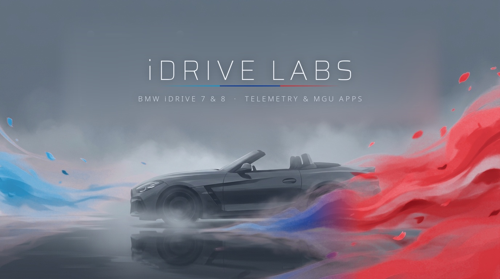
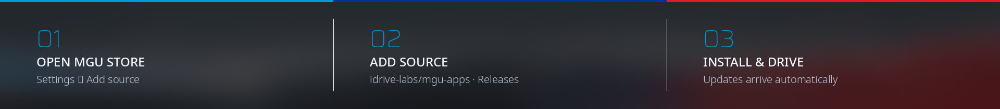
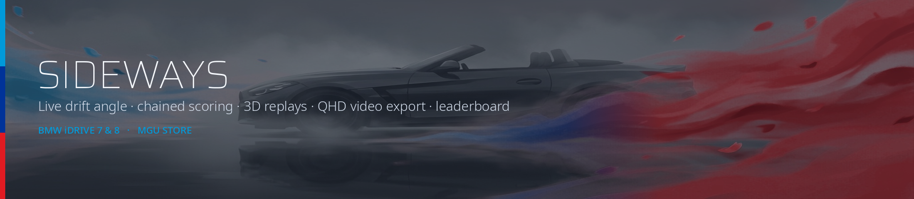

<p align="center">
  
</p>

<p align="center">
  
  
  
</p>

<p align="center"><b>Apps for the centre display of your BMW.</b> Add this source to the MGU Store once,<br>and every app from it installs and updates right from the car.</p>




The source to type in the Store:

```
idrive-labs/mgu-apps
```

You need a BMW with an **iDrive 7 (MGU)** or **iDrive 8** head unit, with root access and the
[MGU Store](https://github.com/robertnisipeanu/mgu-store). Everything an app needs comes with it.


<!-- apps -->
<a href="https://github.com/idrive-labs/sideways"></a>

<p align="center"><a href="https://github.com/idrive-labs/sideways"><b>Sideways</b></a> &nbsp;·&nbsp; <a href="https://github.com/idrive-labs/sideways/releases/latest">Latest release</a> &nbsp;·&nbsp; version 0.6.6 &nbsp;·&nbsp; needs internet for the leaderboard</p>
<!-- /apps -->

> [!WARNING]
> Unofficial apps, not affiliated with or endorsed by BMW AG.

<details>
<summary>For the author: publishing a version</summary>

Each app is built in its own repository into an OAP package, `<id>@<version>.tgz`. A new app gets
an entry in `apps.json` first: title, tagline, description, author, repository, the head units it
is for (`mguHmi`), what it needs, the Store components it requires (`requires`), and a preview image in `previews/`. Then:

```sh
python3 tools/publish.py path/to/<id>@<version>.tgz --icon path/to/icon.png
git add -A && git commit -m "<id> <version>" && git push
```

`publish.py` checks the package, writes `catalog.json`, uploads the package, the icon and the
catalog to the `catalog` release (what the Store reads), draws the cards (`tools/art.py`) and
fills in the list of apps above.
</details>

---

<p align="center">
  <sub>Built for fun by <a href="https://github.com/jarnesence">Járn</a> · <a href="https://github.com/idrive-labs">iDrive Labs</a> · Unofficial hobby project, not affiliated with BMW AG.</sub>
</p>
